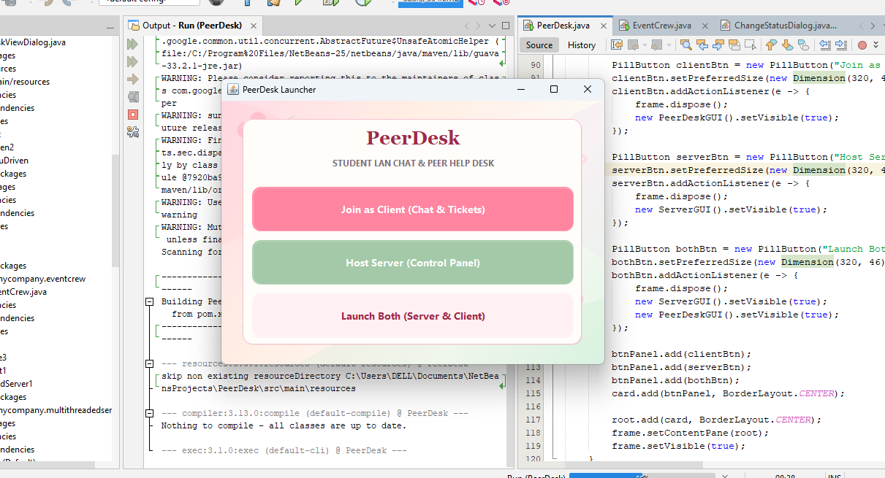
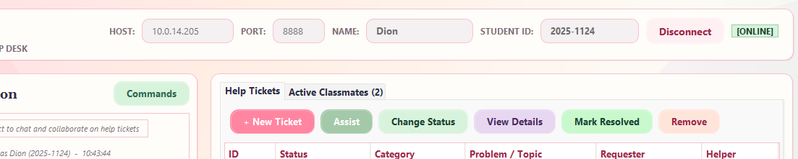
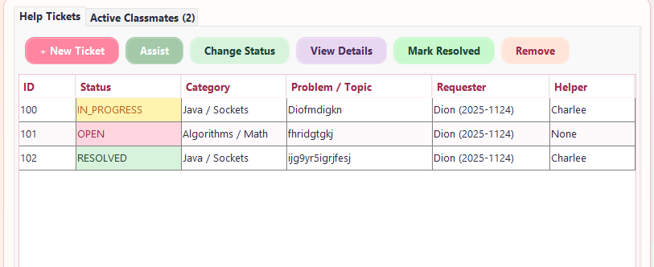

# PeerDesk — Student LAN Collaboration & Peer Help Desk

A multithreaded Java LAN chat application designed for student study groups, lab classrooms, and peer tutoring. Built with Java Sockets (`java.net`), multithreading, and a modern Swing GUI styled in a calming **Pastel Pink & Pastel Green** aesthetic.

---

## Course & Section

| | |
|:---|:---|
| **Course** | ITAS 1 — IT Application and Development with Specialization |
| **Section** | BSIT 2B SD |
| **Institution** | ISUFST (Iligan Institute of Technology) |

## Team Members

| Name | GitHub Username | Role |
|:---|:---|:---|
| Dionne Mariz Perania | [@dionneperania-gif](https://github.com/dionneperania-gif) | Server architecture, ticket system, Swing GUI |
| Charl Lee Basisto | *TBD* | Protocol design, claim workflow, client networking |

---

## 📌 1. Concept Proposal

* **Application Name**: PeerDesk
* **Target Audience**: Classmates and lab partners collaborating on programming assignments, coursework, and technical problem-solving.
* **Core Problem Addressed**: Standard group chats quickly become cluttered with mixed conversation, making it easy for questions, lab bugs, and requests for help to get buried or ignored. Students also have no clear way of knowing who is currently helping whom.
* **Two Original Theme Features**:
  1. **Synchronized Peer Help Ticket Board**: Any student can post a dedicated help ticket with a problem category (e.g., *Java / Sockets*, *GUI / Swing*, *Algorithms*) and a short description. Tickets sync in real-time across all connected peers with visual status badges (`[OPEN]`, `[IN PROGRESS]`, `[RESOLVED]`).
  2. **Helper Claim & Resolution Workflow**: Another student can click **"Assist Peer"** to assign themselves as the active helper (updating the ticket to `[IN PROGRESS: HelperName]` across all screens), and once the peer has been helped, either peer can mark the ticket **`[RESOLVED]`**.
* **Instructor Approval**: `[ Approved ]` *(Record date & instructor initials here)*

---

## 🎨 2. Theme & Visual Style: Modern Pastel & Messenger-Style Chat

The interface features a **clean, modern, pastel-styled workspace**:
* **Full-Window Background**:
  * Rendered via custom Java2D anti-aliased painting (`BotanicalBackgroundPanel.java`).
  * Features a multi-stop diagonal gradient from **soft blush pink (`#FFD6E0`)** to **warm peach (`#FFE5D9`)**, **warm cream (`#FDFBF7`)**, and **soft sage mint (`#D8F3DC`)**.
* **Floating Content Cards (`EditorialCardPanel.java`)**:
  * Large rounded corners ($R = 24\text{px}$) with warm ivory/cream fill (`#FFFDF9`) and soft translucent drop shadows.
  * No default gray Swing components anywhere in the application.
* **Messenger & Instagram DM Style Message Bubbles (`ChatBubbleRow.java`)**:
  * **Outgoing / My Own Messages**: Compact rounded bubbles aligned to the **RIGHT** in soft blush pink (`#FFE6EC`) with deep rose text (`#9E2A4B`).
  * **Incoming Messages**: Compact rounded bubbles aligned to the **LEFT** in pale mint/sage green (`#E8F5E9`) with dark forest sage text (`#1B4332`), displaying the sender nickname clearly above the bubble in bold (`#2D6A4F`).
  * **Dynamic Sizing & Text Wrapping**: Short messages ("hi", "ok") render as small, compact bubbles; longer messages wrap naturally into multiple lines capped at a maximum of ~70% width of the chat feed.
  * **Discreet Timestamps**: Subtle timestamps (`[HH:mm:ss]`) integrated cleanly at the bottom of each bubble.
  * **Subtle System Announcements**: Join, leave, rename, and ticket notifications render as centered, italicized text notices rather than bulky message boxes.
  * **Smooth Continuous Feed & Auto-Scroll**: Vertically stacked `JPanel` conversation feed inside `JScrollPane` that auto-scrolls to the newest message upon arrival while allowing uninterrupted scrolling to older messages.
  * **Fixed Bottom Composer**: Wide rounded input field (`PillTextField`) with Enter-to-send and a dedicated Send button, remaining fixed at the bottom while the message feed scrolls independently.
* **Filled Pill Buttons & Fields (`PillButton.java`, `PillTextField.java`)**:
  * Smooth pill-shaped buttons with solid filled pastel backgrounds (Bubblegum Pink, Sage Green, Soft Mint) and hover highlights.
  * Rounded text fields with filled white/ivory backgrounds, soft interior padding, and blush pink focus glows.
* **Typography & Clean Rendering (Zero Broken Square '□' Glyphs)**:
  * Robust font detection in `BotanicalTheme.java` checking system font availability (`Georgia` fallback to `Serif`, `Segoe UI` fallback to `Arial` / `SansSerif`).
  * Strict typographic hierarchy:
    * **Main Display Titles**: `Georgia` Bold, 26px
    * **Section Headings**: `Georgia` Bold, 18px
    * **Button Text**: `Segoe UI` Bold, 14px
    * **Chat Messages**: `Segoe UI` Regular, 14px (with 1.4 line-height and comfortable bubble padding)
    * **Input Fields**: `Segoe UI` Regular, 14px
    * **Small Labels & Badges**: `Segoe UI` Bold, 12px
    * **Timestamps**: `Segoe UI` Regular, 11px
  * **100% Free of Unsupported Emojis**: All emojis and unsupported Unicode characters across titles, buttons, status badges, chat templates, and network broadcasts have been replaced with elegant text indicators (`[ONLINE]`, `[OFFLINE]`, `[ACTIVE]`, `[STOPPED]`, `+ New Ticket`, `Assist Peer`, `Mark Resolved`, `Remove`), ensuring zero square (`□`) rendering bugs on any OS or machine.

---

## 🌐 3. Network Architecture & Threading Model

```
[ PeerDesk Client 1 ] <--- TCP Socket ---> \
[ PeerDesk Client 2 ] <--- TCP Socket ---> --- [ PeerDesk Server:8888 ]
[ PeerDesk Client 3 ] <--- TCP Socket ---> /      (ClientHandler Threads & Concurrent State)
```

1. **Server (`PeerDeskServer.java`)**:
   * Uses `ServerSocket` running on a configurable port (default: `8888`).
   * Spawns an `ExecutorService` thread pool to manage an independent `ClientHandler` thread for each connected peer.
   * Maintains thread-safe collections (`CopyOnWriteArrayList` for clients, `Collections.synchronizedList` for tickets).
   * Validates non-blank, unique nicknames before admitting clients.
   * Safely broadcasts group chat messages and state updates without blocking.

2. **Client Handler (`ClientHandler.java`)**:
   * Reads incoming client messages on a background loop using UTF-8 `BufferedReader`.
   * Employs a synchronized `writeLock` around the `PrintWriter` to prevent interleaved, corrupt packets during simultaneous socket writes.
   * Releases sockets, streams, and unregisters cleanly when a client exits or disconnects.

3. **Client Network Controller (`PeerDeskClient.java`)**:
   * All network I/O runs completely off the GUI thread to ensure zero UI freezing.
   * Uses a dedicated background `Client-Reader` thread.
   * Dispatches all incoming events (`onChatMessage`, `onUserListUpdated`, `onTicketListUpdated`) to the Swing **Event Dispatch Thread (EDT)** using `SwingUtilities.invokeLater(...)`.

---

## 📡 4. Message Protocol Specification

All communication follows a structured, pipe-delimited text protocol:

| Command / Packet | Direction | Parameters / Description |
| :--- | :--- | :--- |
| `CONNECT\|<nick>` | Client $\rightarrow$ Server | Initial registration request with requested nickname |
| `AUTH_OK\|<assignedNick>` | Server $\rightarrow$ Client | Registration successful; informs client of its active nickname |
| `AUTH_ERR\|<reason>` | Server $\rightarrow$ Client | Handshake failed (e.g., nickname blank or already in use) |
| `CHAT\|<message>` | Client $\rightarrow$ Server | Chat message to broadcast to all peers |
| `CHAT_MSG\|<time>\|<sender>\|<msg>` | Server $\rightarrow$ All | Broadcasts chat message with timestamp and sender nickname |
| `SYS_MSG\|<time>\|<message>` | Server $\rightarrow$ All | Broadcasts announcements (joins, leaves, renames, ticket updates) |
| `USER_LIST\|<nick1>,<nick2>,...` | Server $\rightarrow$ All | Sends comma-separated list of currently connected peers |
| `NAME\|<newNick>` | Client $\rightarrow$ Server | Triggered by `/name <newname>` command |
| `NAME_OK\|<newNick>` | Server $\rightarrow$ Client | Confirms nickname successfully updated |
| `NAME_ERR\|<reason>` | Server $\rightarrow$ Client | Rejects nickname change (e.g., duplicate nickname) |
| `EXIT` | Client $\rightarrow$ Server | Triggered by `/exit` or window close; closes connection |
| `TICKET_NEW\|<cat>\|<subject>` | Client $\rightarrow$ Server | Creates a new help ticket in category with subject |
| `TICKET_CLAIM\|<id>` | Client $\rightarrow$ Server | Assigns active client as the helper for ticket `<id>` |
| `TICKET_RESOLVE\|<id>` | Client $\rightarrow$ Server | Marks ticket `<id>` as `RESOLVED` |
| `TICKET_DELETE\|<id>` | Client $\rightarrow$ Server | Removes ticket `<id>` from the board |
| `TICKET_LIST\|<ticket1>@@...` | Server $\rightarrow$ All | Broadcasts serialized list of all tickets across the LAN |

---

## 🚀 5. How to Run and Test in Apache NetBeans

### Prerequisites

| Requirement | Version / Details |
|:---|:---|
| **Java JDK** | Java 26 (Oracle JDK 26+35-2893 or compatible) |
| **IDE** | Apache NetBeans IDE 25 |
| **Build Tool** | Apache Maven (bundled with NetBeans) |
| **Dependencies** | JUnit Jupiter 5.10.0 (test scope only — auto-downloaded by Maven) |
| **Network** | LAN / Wi-Fi for multi-computer testing; localhost for single-machine testing |
| **Port** | `8888` (default; must be available) |

> **Note:** PeerDesk uses only the Java Standard Library (`java.net`, `java.io`, `javax.swing`, `java.awt`). No external runtime dependencies are required beyond the JDK.

### A. Quick Launch (Launcher Window)
1. Open the **PeerDesk** project in NetBeans.
2. Click the green **Run Project** button (or press `F6`).
3. A friendly launcher window will appear with three options:
   * **🌸 Join as Peer (Client GUI)**: Launches a client chat window.
   * **🍃 Host Server (Server Panel)**: Launches the Server Control Panel (shows detected LAN IP, port, and live activity log).
   * **🚀 Launch Both**: Starts the server and client simultaneously on your computer.

### B. Testing 3 Concurrent Clients on One Computer (Localhost)
1. Run `PeerDesk` and click **"Host Server"** (or run with argument `--server`).
2. Run `PeerDesk` again and click **"Join as Peer"** (connect as `Alice`).
3. Run `PeerDesk` again and click **"Join as Peer"** (connect as `Bob`).
4. Run `PeerDesk` again and click **"Join as Peer"** (connect as `Charlie`).
5. You can now chat between all three windows, post tickets, claim them, and test `/name`, `/help`, and `/exit`.

### C. Testing Across Two Computers on the Same LAN / Wi-Fi
1. Ensure both computers are connected to the same Wi-Fi or router network.
2. On **Computer 1 (Host)**:
   * Start the **PeerDesk Server**. Look at the bottom of the Server Control Panel to see your LAN IP (e.g., `192.168.1.45`).
   * *(Note: If Windows Defender Firewall prompts, allow Java on Private Networks).*
   * On Computer 1, open a client and connect to `localhost` on port `8888`.
3. On **Computer 2 (Partner Computer)**:
   * Run the PeerDesk Client.
   * In the **Server IP** field, enter Computer 1's LAN IP (e.g., `192.168.1.45`).
   * In the **Port** field, enter `8888`.
   * Enter a nickname and click **Connect**.
4. Both computers will now see each other in real time!

### D. Chat Commands Reference

| Command | Description |
|:---|:---|
| `/name <newname>` | Change your display nickname (must be unique among connected peers) |
| `/help` | Display a list of all available commands inside the chat window |
| `/exit` | Gracefully disconnect from the server and close the client |

---

## 🔧 5.1. Troubleshooting

| Problem | Cause | Solution |
|:---|:---|:---|
| `Address already in use: bind` on server start | Port 8888 is occupied by another process | Run `free_port_8888.bat` (included in repo) or change to a different port |
| Client cannot connect to server on another PC | Firewall blocking Java or port 8888 | On the host PC, allow Java through Windows Defender Firewall for **Private Networks** |
| Client shows "Connection refused" | Server is not running, or wrong IP/port entered | Verify the server is started first; double-check the LAN IP shown on the Server Control Panel |
| Blank square characters (`□`) in the UI | System font missing or incompatible | PeerDesk already uses safe fallback fonts (`Georgia` → `Serif`, `Segoe UI` → `SansSerif`). Update your JDK if issue persists |
| `mvn` command not found in terminal | Maven not on system PATH | Use NetBeans' built-in Run (F6) instead, or add Maven's `bin/` folder to your system PATH |

---

## 🧪 6. Test Results

### 6.1. Automated System Verification

PeerDesk includes an automated verification test class (`com.mycompany.peerdesk.test.SystemVerificationTest`). Run it in NetBeans or via terminal:

```powershell
mvn compile
java -cp target/classes com.mycompany.peerdesk.test.SystemVerificationTest
```

### 6.2. Test Table

| # | Test Case | Steps | Expected Result | Actual Result | Status |
|:---:|:---|:---|:---|:---|:---:|
| 1 | Server startup | Start PeerDeskServer on port 9876 | Server binds to port and begins listening | Server started successfully on port 9876 | PASS |
| 2 | Concurrent client connections | Connect 3 clients (Alice, Bob, Charlie) to the server simultaneously | All 3 clients connect and appear in user list | 3 clients connected concurrently; all visible in user list | PASS |
| 3 | Duplicate nickname rejection | Attempt to connect a 4th client using the nickname "Alice" (already taken) | Server rejects with `AUTH_ERR` and reason message | Received: "Nickname 'Alice' is already in use by another peer." | PASS |
| 4 | Group chat broadcast | Alice sends a chat message | Bob and Charlie both receive the message with correct timestamp and sender | Message received by both peers with `CHAT_MSG\|<time>\|Alice\|<msg>` format | PASS |
| 5 | Ticket creation and sync (Feature 1) | Alice creates a new help ticket with category "Java / Sockets" | Ticket appears as `[OPEN]` on all 3 clients' ticket boards | New ticket broadcast to all peers with OPEN status | PASS |
| 6 | Helper claim and resolution (Feature 2) | Charlie clicks "Assist Peer" on Alice's ticket, then marks it "Resolved" | Ticket status updates to `[IN PROGRESS: Charlie]` then `[RESOLVED]` across all clients | Ticket claimed by Charlie and marked RESOLVED; all clients updated | PASS |
| 7 | Nickname rename (`/name`) | Alice types `/name Alicia` | Server confirms rename; user lists on all clients update from "Alice" to "Alicia" | Renamed to Alicia; user lists updated on all connected peers | PASS |
| 8 | Disconnect resilience | Charlie disconnects via `/exit` | Server removes Charlie; Alice and Bob remain connected and functional | Server and remaining 2 clients operate without interruption | PASS |

> **Result: 8 / 8 tests passed (100%)**

### 6.3. Console Output Evidence

```
=================================================
   PEERDESK SYSTEM VERIFICATION TEST
=================================================
[1/8] Starting PeerDesk Server on port 9876... PASSED
[2/8] Connecting 3 concurrent clients (Alice, Bob, Charlie)... PASSED (3 clients connected concurrently)
[3/8] Testing duplicate nickname rejection (joining as 'Alice' again)... PASSED (Nickname 'Alice' is already in use by another peer.)
[4/8] Testing group chat broadcast from Alice to Bob & Charlie... PASSED (Received message with timestamp from Alice)
[5/8] Testing Theme Feature 1 (Ticket Creation & Sync)... PASSED (New ticket successfully broadcast to all peers)
[6/8] Testing Theme Feature 2 (Helper Claim & Resolution)... PASSED (Ticket claimed by Charlie and marked RESOLVED)
[7/8] Testing slash command /name (Alice renames to Alicia)... PASSED (Renamed to Alicia, user lists updated)
[8/8] Testing disconnect resilience (Charlie exits, Alice and Bob remain)... PASSED (Server and remaining 2 clients operate without interruption)

ALL 8 SYSTEM VERIFICATION TESTS PASSED SUCCESSFULLY! 100% COMPLIANT WITH RUBRIC.
```

---

## 📸 Screenshots

> **TODO**: Add labeled screenshots to a `screenshots/` folder in this repository and update the paths below.

### Launcher Window
<!--  -->
*Screenshot: The PeerDesk launcher showing "Join as Peer", "Host Server", and "Launch Both" buttons.*

### Server Control Panel
<!--  -->
*Screenshot: Server running on port 8888 with LAN IP display and live activity log.*

### Client Chat Window (Messenger-Style Bubbles)
<!--  -->
*Screenshot: Chat interface with pastel pink outgoing bubbles (right) and pastel green incoming bubbles (left).*

### Peer Help Ticket Board
<!--  -->
*Screenshot: Ticket board showing tickets with [OPEN], [IN PROGRESS], and [RESOLVED] status badges.*

### 3-Client Concurrent Test
<!--  -->
*Screenshot: Three client windows (Alice, Bob, Charlie) connected simultaneously on localhost.*

---

## 👥 7. Pair Contribution Log

| Date | Partner | Task / Contribution | Status / Commit |
| :--- | :--- | :--- | :--- |
| Nov 20, 2026 | Dionne Mariz Perania | Server socket architecture, `ClientHandler` thread pool, synchronization locks | Completed |
| Nov 20, 2026 | Charl Lee Basisto | Message protocol definition, `Protocol.java`, unique nickname validation logic | Completed |
| Nov 20, 2026 | Dionne Mariz Perania | Original Feature 1: Help ticket data model & real-time server ticket sync | Completed |
| Nov 20, 2026 | Charl Lee Basisto | Original Feature 2: Helper claim & resolution workflow state management | Completed |
| Nov 20, 2026 | Dionne Mariz Perania | Swing Client GUI implementation with Pastel Pink & Pastel Green visual styling | Completed |
| Nov 20, 2026 | Charl Lee Basisto | Client network reader, thread-safe EDT dispatching (`SwingUtilities.invokeLater`) | Completed |
| Nov 20, 2026 | Both | 3-client concurrent testing, LAN multi-computer testing, documentation | Verified |

---

## 🎓 8. Oral Defense & Demonstration Guide

During your presentation, be prepared to answer:

1. **How do messages travel from one client to another?**
   * *Answer*: When a client types a message and clicks Send, `PeerDeskClient` formats it as `CHAT|<msg>` and writes it to the socket. The server's `ClientHandler` reads it in its loop, calls `server.broadcastChatMessage()`, which iterates over the `clients` list and writes `CHAT_MSG|<time>|<sender>|<msg>` to each client socket. Each client's reader thread receives it and queues a GUI update via `SwingUtilities.invokeLater()`.

2. **Why doesn't the GUI freeze while waiting for network messages?**
   * *Answer*: All blocking socket calls (`socket.connect()` and `in.readLine()`) run in separate background threads (`Client-Reader`). Swing's Event Dispatch Thread (EDT) only handles UI rendering and button clicks, so it remains 100% responsive at all times.

3. **How is thread safety and concurrent sending handled?**
   * *Answer*:
     * Connected clients are stored in a thread-safe `CopyOnWriteArrayList`.
     * Shared tickets are wrapped in `Collections.synchronizedList`.
     * `PrintWriter.println()` writes on each socket are guarded by a `synchronized(writeLock)` block so two threads cannot interleave bytes on the same TCP stream.
