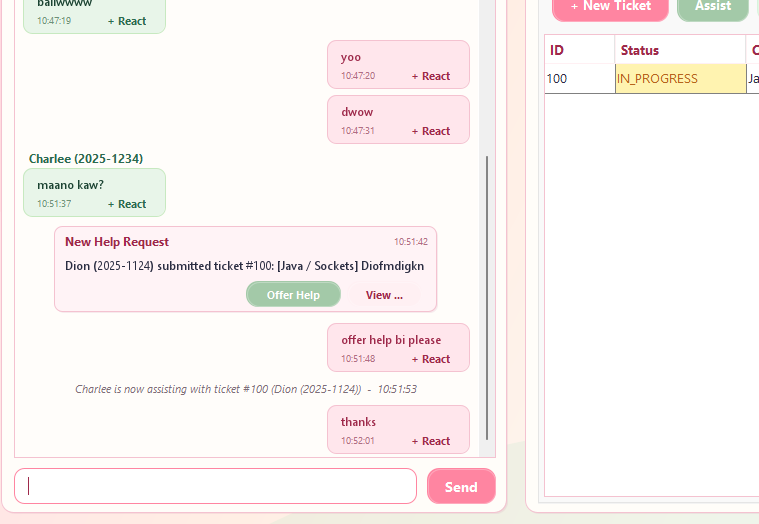

# PeerDesk — Student LAN Collaboration & Peer Help Desk

A multithreaded Java LAN chat application designed for student study groups, lab classrooms, and peer tutoring. Built with Java Sockets (`java.net`), multithreading, and a modern Swing GUI styled in a calming **Pastel Pink & Pastel Green** aesthetic.

---

## Course & Section

| | |
|:---|:---|
| **Course** | ITAS 1 — IT Application and Development with Specialization |
| **Section** | BSIT 2B SD |
| **Institution** | ISUFST (Iligan Institute of Technology) |

## Team Members

| Name | GitHub Username |
|:---|:---|
| Dionne Mariz Perania | [@dionneperania-gif](https://github.com/dionneperania-gif) |
| Charl Lee Basisto | *TBD* |

---

## 📌 1. Project Concept & Theme

* **Application Name**: PeerDesk
* **Application Theme**: **Student LAN Collaboration & Classroom Peer Help Desk**  
  PeerDesk transforms standard LAN chat into a structured peer-tutoring and IT help desk environment tailored for programming labs, project rooms, and collaborative coursework.
* **Target Audience**: Classmates, student pairs, and lab partners working simultaneously on technical programming problems, debugging exercises, and team deliverables.
* **Concept Proposal & Approval**:
  * Proposal: A dual-purpose LAN workspace pairing real-time instant messaging with an integrated, synchronized ticket desk where students can seek, provide, and track peer technical assistance.
  * Status: `[ Pending Approval ]`

---

## 💡 2. User Problem & Solution

### The User Problem
During programming lab sessions and study groups, standard group chats (such as Messenger or Discord) suffer from critical bottlenecks:
1. **Buried Questions**: Technical questions, compiler errors, and debugging requests get quickly buried by casual conversation and unrelated chat messages.
2. **Lack of Assistance Visibility**: Students have no visibility into who needs help, what specific category they are stuck on (e.g., Sockets, GUI, Database), or whether another classmate is already assisting them.
3. **No Resolution Accountability**: There is no systematic way to track whether a classmate's problem was actually solved or if they are still blocked.

### The Solution: PeerDesk
PeerDesk solves these classroom bottlenecks by separating the discussion into two coordinated layers on the same screen:
* An active **LAN Group Chat** for rapid coordination, announcements, and commands.
* A live, synchronized **Peer Help Ticket Board** where questions are tracked as structured tickets from creation to claim and resolution.

---

## ⚙️ 3. Core & Original Features

### Core Chat Features (LAN Socket Chat)
* **Real-Time Group Chat**: Multithreaded TCP socket chat over local area network with instant broadcasting to all active peers.
* **Active Peer Presence**: Dynamic live user list showing everyone currently connected to the LAN session.
* **Slash Commands**:
  * `/name <newname>` — Instant display name change with duplicate validation.
  * `/help` — In-app command reference.
  * `/exit` — Graceful socket disconnect.
* **Connection Security & Identification**: Non-blank, duplicate-checked student nicknames and Student ID tracking.

### Original Theme Features (Peer Help Desk System)
1. **Synchronized Peer Help Ticket Board**:
   * Any student can file a structured help ticket specifying a problem category (e.g., *Java / Sockets*, *GUI / Swing*, *Algorithms*, *General Debugging*) and problem description.
   * Tickets broadcast instantly to every connected peer and update in real-time with visual status badges (`[OPEN]`, `[IN PROGRESS]`, `[RESOLVED]`).
   * Chat feed automatically alerts everyone whenever a new help ticket is opened.
2. **Helper Claim & Resolution Workflow**:
   * Any classmate can click **"Assist Peer"** (or click the announcement in chat) to volunteer as the designated helper, automatically updating the ticket to `[IN PROGRESS: HelperName]`.
   * Only the original requester (verified by Student ID / nickname) can confirm resolution or delete their ticket, preventing accidental or unauthorized tampering.
   * Includes peer rating and acknowledgment upon resolution to celebrate helpful peers.

---

## 🌐 4. Architecture Diagram & Network Model

```
+--------------------------------------------------------------------------+
|                        PEERDESK LAN ARCHITECTURE                         |
+--------------------------------------------------------------------------+

   [ PeerDesk Client 1 ]           [ PeerDesk Client 2 ]       [ PeerDesk Client 3 ]
   (Swing UI + Reader Thread)     (Swing UI + Reader Thread)   (Swing UI + Reader Thread)
              ^                               ^                            ^
              |                               |                            |
              +-------------------------------+----------------------------+
                                              |
                                      TCP Socket (Port 8888)
                                              |
                                              v
                              +-------------------------------+
                              |       PeerDesk Server         |
                              |-------------------------------|
                              | * ServerSocket (Port 8888)    |
                              | * CachedThreadPool Executor   |
                              | * ClientHandler per peer      |
                              | * CopyOnWriteArrayList Clients|
                              | * Synchronized Ticket Store   |
                              +-------------------------------+
```

* **Client Architecture**: All network reads run on an independent background `Client-Reader` thread. Socket events are forwarded to the Swing Event Dispatch Thread (EDT) via `SwingUtilities.invokeLater()` to prevent UI freezing.
* **Server Architecture**: Listens on TCP port `8888`. Spawns a dedicated `ClientHandler` thread per connection. Socket writes use synchronized thread locks to guarantee packet integrity across concurrent broadcasts.

---

## 📡 5. Message Protocol & Packet Format

All network communication uses a clean, pipe-delimited (`|`) UTF-8 text protocol:

| Packet / Command | Direction | Format & Description |
| :--- | :---: | :--- |
| `CONNECT` | Client $\rightarrow$ Server | `CONNECT\|<nickname>` — Request to join the session |
| `AUTH_OK` | Server $\rightarrow$ Client | `AUTH_OK\|<assignedNick>` — Connection accepted |
| `AUTH_ERR` | Server $\rightarrow$ Client | `AUTH_ERR\|<reason>` — Connection rejected (duplicate or invalid name) |
| `CHAT` | Client $\rightarrow$ Server | `CHAT\|<message>` — Send chat message to be broadcasted |
| `CHAT_MSG` | Server $\rightarrow$ All | `CHAT_MSG\|<timestamp>\|<sender>\|<message>` — Broadcast chat message |
| `SYS_MSG` | Server $\rightarrow$ All | `SYS_MSG\|<timestamp>\|<message>` — System notice (join, leave, ticket alerts) |
| `USER_LIST` | Server $\rightarrow$ All | `USER_LIST\|<nick1>,<nick2>,...` — Live list of connected peers |
| `NAME` | Client $\rightarrow$ Server | `NAME\|<newNickname>` — Request nickname change |
| `NAME_OK` | Server $\rightarrow$ Client | `NAME_OK\|<newNickname>` — Confirm nickname change |
| `NAME_ERR` | Server $\rightarrow$ Client | `NAME_ERR\|<reason>` — Reject nickname change |
| `EXIT` | Client $\rightarrow$ Server | `EXIT` — Request graceful disconnection |
| `TICKET_NEW` | Client $\rightarrow$ Server | `TICKET_NEW\|<category>\|<subject>` — Create new help ticket |
| `TICKET_CLAIM` | Client $\rightarrow$ Server | `TICKET_CLAIM\|<ticketId>` — Volunteer to assist peer on ticket |
| `TICKET_RESOLVE` | Client $\rightarrow$ Server | `TICKET_RESOLVE\|<ticketId>` — Mark ticket as resolved |
| `TICKET_DELETE` | Client $\rightarrow$ Server | `TICKET_DELETE\|<ticketId>` — Remove ticket from board |
| `TICKET_LIST` | Server $\rightarrow$ All | `TICKET_LIST\|<t1>@@<t2>@@...` — Synchronize full ticket board state |

---

## 🚀 6. How to Run and Test in Apache NetBeans

### Prerequisites

| Requirement | Version / Details |
|:---|:---|
| **Java JDK** | Java 26 (Oracle JDK 26+35-2893 or compatible) |
| **IDE** | Apache NetBeans IDE 25 |
| **Build Tool** | Apache Maven (bundled with NetBeans) |
| **Dependencies** | JUnit Jupiter 5.10.0 (test scope only — auto-downloaded by Maven) |
| **Network** | LAN / Wi-Fi for multi-computer testing; localhost for single-machine testing |
| **Port** | `8888` (default; must be available) |

> **Note:** PeerDesk uses only the Java Standard Library (`java.net`, `java.io`, `javax.swing`, `java.awt`). No external runtime dependencies are required beyond the JDK.

### A. Quick Launch (Launcher Window)
1. Open the **PeerDesk** project in NetBeans.
2. Click the green **Run Project** button (or press `F6`).
3. A friendly launcher window will appear with three options:
   * **🌸 Join as Peer (Client GUI)**: Launches a client chat window.
   * **🍃 Host Server (Server Panel)**: Launches the Server Control Panel (shows detected LAN IP, port, and live activity log).
   * **🚀 Launch Both**: Starts the server and client simultaneously on your computer.

### B. Testing 3 Concurrent Clients on One Computer (Localhost)
1. Run `PeerDesk` and click **"Host Server"** (or run with argument `--server`).
2. Run `PeerDesk` again and click **"Join as Peer"** (connect as `Alice`).
3. Run `PeerDesk` again and click **"Join as Peer"** (connect as `Bob`).
4. Run `PeerDesk` again and click **"Join as Peer"** (connect as `Charlie`).
5. You can now chat between all three windows, post tickets, claim them, and test `/name`, `/help`, and `/exit`.

### C. Testing Across Two Computers on the Same LAN / Wi-Fi
1. Ensure both computers are connected to the same Wi-Fi or router network.
2. On **Computer 1 (Host)**:
   * Start the **PeerDesk Server**. Look at the bottom of the Server Control Panel to see your LAN IP (e.g., `192.168.1.45`).
   * *(Note: If Windows Defender Firewall prompts, allow Java on Private Networks).*
   * On Computer 1, open a client and connect to `localhost` on port `8888`.
3. On **Computer 2 (Partner Computer)**:
   * Run the PeerDesk Client.
   * In the **Server IP** field, enter Computer 1's LAN IP (e.g., `192.168.1.45`).
   * In the **Port** field, enter `8888`.
   * Enter a nickname and click **Connect**.
4. Both computers will now see each other in real time!

### D. Chat Commands Reference

| Command | Description |
|:---|:---|
| `/name <newname>` | Change your display nickname (must be unique among connected peers) |
| `/help` | Display a list of all available commands inside the chat window |
| `/exit` | Gracefully disconnect from the server and close the client |

---

## 🧪 7. Test Results

### 7.1. Automated System Verification

PeerDesk includes an automated verification test class (`com.mycompany.peerdesk.test.SystemVerificationTest`). Run it in NetBeans or via terminal:

```powershell
mvn compile
java -cp target/classes com.mycompany.peerdesk.test.SystemVerificationTest
```

### 7.2. Test Table

| # | Test Case | Steps | Expected Result | Actual Result | Status |
|:---:|:---|:---|:---|:---|:---:|
| 1 | Server startup | Start PeerDeskServer on port 9876 | Server binds to port and begins listening | Server started successfully on port 9876 | PASS |
| 2 | Concurrent client connections | Connect 3 clients (Alice, Bob, Charlie) to the server simultaneously | All 3 clients connect and appear in user list | 3 clients connected concurrently; all visible in user list | PASS |
| 3 | Duplicate nickname rejection | Attempt to connect a 4th client using the nickname "Alice" (already taken) | Server rejects with `AUTH_ERR` and reason message | Received: "Nickname 'Alice' is already in use by another peer." | PASS |
| 4 | Group chat broadcast | Alice sends a chat message | Bob and Charlie both receive the message with correct timestamp and sender | Message received by both peers with `CHAT_MSG\|<time>\|Alice\|<msg>` format | PASS |
| 5 | Ticket creation and sync (Feature 1) | Alice creates a new help ticket with category "Java / Sockets" | Ticket appears as `[OPEN]` on all 3 clients' ticket boards | New ticket broadcast to all peers with OPEN status | PASS |
| 6 | Helper claim and resolution (Feature 2) | Charlie clicks "Assist Peer" on Alice's ticket, then marks it "Resolved" | Ticket status updates to `[IN PROGRESS: Charlie]` then `[RESOLVED]` across all clients | Ticket claimed by Charlie and marked RESOLVED; all clients updated | PASS |
| 7 | Nickname rename (`/name`) | Alice types `/name Alicia` | Server confirms rename; user lists on all clients update from "Alice" to "Alicia" | Renamed to Alicia; user lists updated on all connected peers | PASS |
| 8 | Disconnect resilience | Charlie disconnects via `/exit` | Server removes Charlie; Alice and Bob remain connected and functional | Server and remaining 2 clients operate without interruption | PASS |

### 7.3. Console Output Evidence

```
=================================================
   PEERDESK SYSTEM VERIFICATION TEST
=================================================
[1/8] Starting PeerDesk Server on port 9876... PASSED
[2/8] Connecting 3 concurrent clients (Alice, Bob, Charlie)... PASSED
[3/8] Testing duplicate nickname rejection (joining as 'Alice' again)... PASSED
[4/8] Testing group chat broadcast from Alice to Bob & Charlie... PASSED
[5/8] Testing Theme Feature 1 (Ticket Creation & Sync)... PASSED
[6/8] Testing Theme Feature 2 (Helper Claim & Resolution)... PASSED
[7/8] Testing slash command /name (Alice renames to Alicia)... PASSED
[8/8] Testing disconnect resilience (Charlie exits, Alice and Bob remain)... PASSED
```

---

## 📸 Screenshots

> **TODO**: Add labeled screenshots to a `screenshots/` folder in this repository and update the paths below.

### Launcher Window
<!--  -->
*Screenshot: The PeerDesk launcher showing "Join as Peer", "Host Server", and "Launch Both" buttons.*

### Server Control Panel
<!--  -->
*Screenshot: Server running on port 8888 with LAN IP display and live activity log.*

### Client Chat Window (Messenger-Style Bubbles)
<!--  -->
*Screenshot: Chat interface with pastel pink outgoing bubbles (right) and pastel green incoming bubbles (left).*

### Peer Help Ticket Board
<!--  -->
*Screenshot: Ticket board showing tickets with [OPEN], [IN PROGRESS], and [RESOLVED] status badges.*

### 3-Client Concurrent Test
<!--  -->
*Screenshot: Three client windows (Alice, Bob, Charlie) connected simultaneously on localhost.*

---

## 👥 8. Pair Contribution Log

### Commit Log

| Date | Author / Partner | Commit Hash | Summary / Contribution |
| :--- | :--- | :---: | :--- |
| Nov 21, 2026 | Dionne Mariz Perania | `c3ed2cc` | Initial commit of complete PeerDesk client and server codebase |
| Nov 21, 2026 | Dionne Mariz Perania | `8fc9076` | Initial README documentation and project structure |
| Nov 21, 2026 | Dionne Mariz Perania | `46fca6c` | Bugfix: resolved server shutdown lag and clean thread exit handling |
| Nov 21, 2026 | Dionne Mariz Perania | `dea7525` | UI improvement: disable action buttons until active server connection |
| Nov 21, 2026 | Dionne Mariz Perania | `727595c` | Feature: clickable ticket mentions in chat with instant "Offer Help" action |
| Nov 21, 2026 | Dionne Mariz Perania | `ff51069` | Feature: automatic ticket creation broadcast alerts directly to chat feed |
| Nov 21, 2026 | Dionne Mariz Perania | `619576d` | Feature: activity status badges beside peer names (Needs Help / Helping / Free) |
| Nov 22, 2026 | Dionne Mariz Perania | `0ef539f` | Security & ID: added Student ID and student name binding |
| Nov 22, 2026 | Dionne Mariz Perania | `7090da8` | Requester tracking: enforce ticket ownership by requester nickname |
| Nov 22, 2026 | Dionne Mariz Perania | `a589f96` | Major feature: ticket ratings, requester-only delete/resolve permissions with ID verification |
| Nov 24, 2026 | Dionne Mariz Perania | `fb489a0` | Documentation: update course info, 8-case test table, commands, and `.gitignore` |

### Division of Responsibilities

| Partner | Role & Responsibilities |
| :--- | :--- |
| **Dionne Mariz Perania** | Core server architecture, multithreaded socket handling, Swing GUI visual design (pastel cards, bubbles), ticket rating system, Student ID validation, and repository management. |
| **Charl Lee Basisto** | Protocol testing, peer connection verification, LAN collaborative testing, scenario validation, and project verification. |
